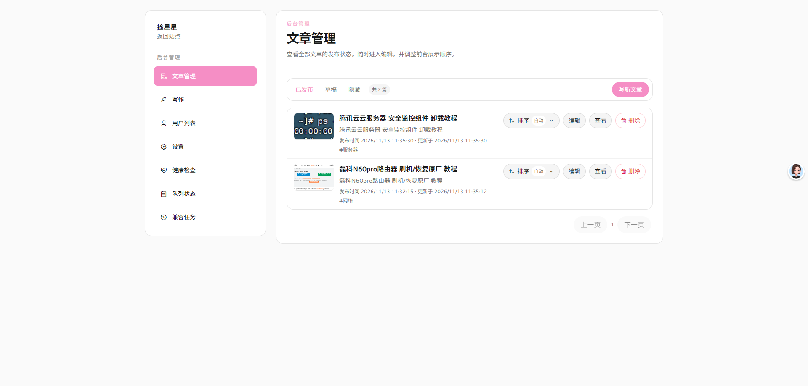
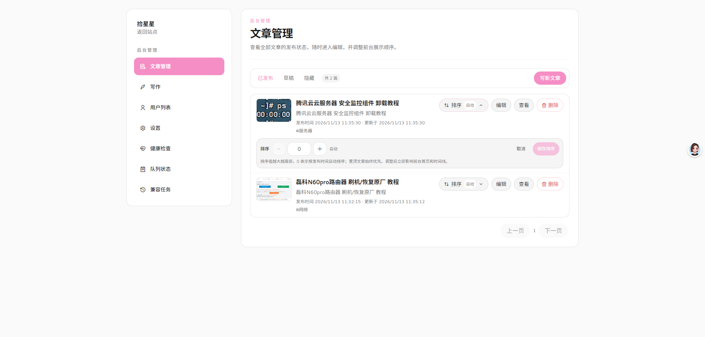
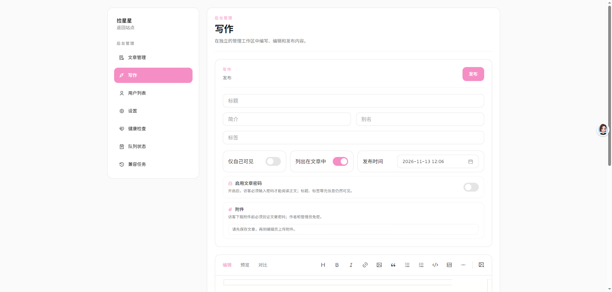
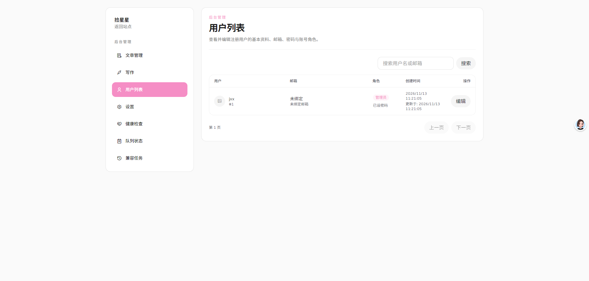
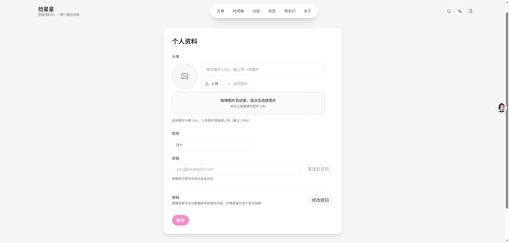
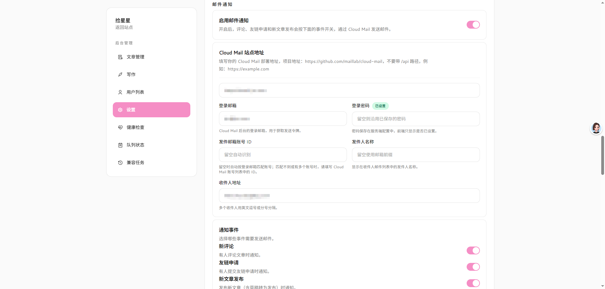
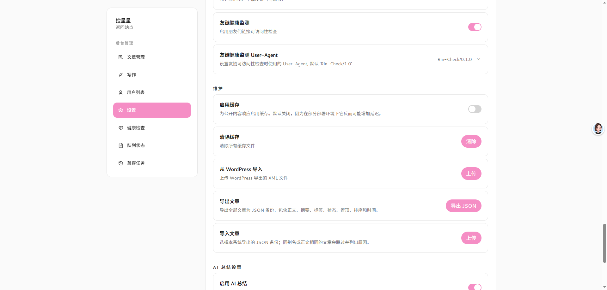
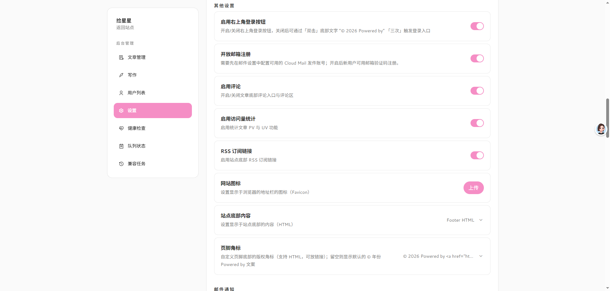
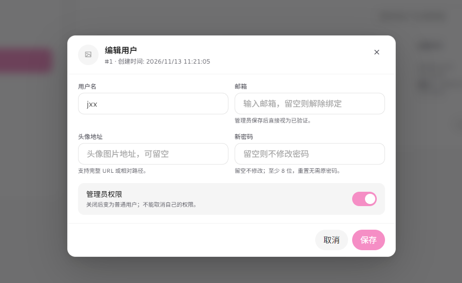

# Rin-New

[https://github.com/jxx-one/Rin-New#rin-new](https://github.com/jxx-one/Rin-New#rin-new)

<p align="center">
  
  
  
  
</p>

> 🍊 Rin-New 是基于 [Rin](https://github.com/openRin/Rin) 博客二次开发的个人博客系统，保留原版轻量、简洁的写作体验，并继续使用 Cloudflare Pages、Cloudflare Workers 与 D1 完成部署。

相比原版，Rin-New 补齐了更完整的后台内容管理、文章权限、用户体系、邮件通知和数据迁移能力，同时对后台界面、注册页、弹窗与中文显示等细节做了重新整理和美化。✨

原版已有的文章、标签、动态、朋友、评论、RSS、AI 摘要、主题、Webhook、对象存储等功能继续保留；下面是这个分支相对原版的主要变化。

## 🆚 与原版的区别

| 方面 | 原版 Rin | Rin-New |
| :-- | :-- | :-- |
| 🗂️ 后台文章管理 | 主要围绕写作页 | 增加独立文章列表，可按已发布、草稿、隐藏分类浏览和管理 |
| ✏️ 文章操作 | 编辑入口相对简单 | 文章列表中可直接编辑、查看、删除，并可调整展示顺序 |
| 🔐 内容权限 | 没有文章级密码 | 支持给单篇文章设置访问密码，访客验证后才能阅读正文 |
| 📎 文章附件 | 没有文章附件能力 | 支持在文章中上传多个附件，并随文章一起展示和下载 |
| 🛡️ 附件权限 | 无 | 加密文章的附件同样需要先验证密码；作者和管理员下载自己的附件免密 |
| 👥 用户体系 | 以管理员和外部登录为主 | 增加邮箱验证码注册、普通用户账号、个人资料和后台用户管理 |
| 🪪 用户资料 | 能力有限 | 登录后可修改用户名、邮箱、头像和密码；后台可统一编辑用户资料、重置密码和调整角色 |
| 📬 邮件能力 | 原版配置较少 | 增加 Cloud Mail 邮件配置、测试邮件和事件通知 |
| 📦 文章迁移 | 原版没有同系统导入导出 | 支持把本站文章导出为 JSON，再导入另一个 Rin-New 站点 |
| 🏷️ 页脚品牌 | 固定页脚文案 | 可在后台自定义页脚版权角标，支持更灵活的站点署名 |
| 🎨 界面与中文 | 原版界面较基础 | 后台弹窗、注册页、列表布局和中文文案做了重新设计，中文界面更稳定 |
| 🧩 稳定性 | 原版基础实现 | 修复弹窗关闭后页面滚动被锁住、头像破图、后台偶发英文等体验问题 |

## 🗂️ 后台文章管理

原版的后台更偏向 “直接写作”，Rin-New 增加了一个更完整的文章管理区。

文章会按状态分成 **已发布**、**草稿** 和 **隐藏** 三类，列表中可以快速看到封面、标题、摘要、发布时间、更新时间、标签，以及置顶、加密等状态。每篇文章都可以直接编辑、查看前台效果或删除；删除前会二次确认，避免误操作。🫶

对于需要长期维护的博客，文章还可以单独设置展示顺序。置顶文章仍然优先，其次是手动排序值，最后才按时间排序。这样可以把系列文章、重要文章或专题内容固定在更靠前的位置，而不必修改发布时间。

| 文章管理 | 手动排序 |
| :--: | :--: |
|  |  |

<p align="center"><em>按状态筛选文章，并直接在列表中调整前台展示顺序</em></p>

## 🔐 文章密码访问

原版文章默认公开。Rin-New 可以为单篇文章开启密码访问。

开启后，访客仍然能看到标题、标签等基本信息，但正文会被隐藏，必须输入正确密码才能阅读。密码验证面板会跟随后台配置的主题色变化，不再是一套固定配色。作者和管理员登录后访问自己的文章不受密码限制。🔓

这个能力适合放一些不想完全公开、但又不希望依赖复杂会员系统的内容，例如私人笔记、阶段性草稿、给朋友看的文章或内部资料。

## 📎 文章附件与密码下载

Rin-New 在写作页增加了附件区域，可以给一篇文章挂载多个文件，并在前台文章底部展示。

没有设置密码的文章，访客可以直接下载附件；设置了密码的文章，访客必须先验证密码，附件文件名和下载入口才会出现。作者和管理员下载自己的附件时不需要重复验证密码。✅

删除文章时，附件记录和对应的存储对象会一起清理，避免留下孤立文件。附件本身存放在私有对象存储中，不会把真实存储路径暴露给前台。

<p align="center">
  
</p>

<p align="center"><em>写作页可直接开启文章密码，并在同一页配置文件附件</em></p>

## 👥 邮箱验证码注册与用户中心

原版主要面向单管理员使用。Rin-New 增加了一套更完整的普通用户体系。

管理员可以在后台配置 Cloud Mail 邮件服务，并决定是否开放邮箱注册。开放后，访客使用邮箱获取验证码即可创建账号，注册成功后会自动登录。🎉

登录用户可以进入个人资料页，修改用户名、头像、邮箱和密码。修改邮箱时需要先验证新邮箱，避免误填或占用他人邮箱。

后台增加用户列表，管理员可以搜索用户，并查看邮箱验证状态、角色、密码状态和注册时间。每个用户都可以单独编辑资料、重置密码或调整管理员权限；管理员不能取消自己的权限，防止把自己锁在后台之外。🔐

| 用户列表 | 个人资料 |
| :--: | :--: |
|  |  |

<p align="center"><em>后台统一管理用户，登录用户可自行维护头像、昵称、邮箱和密码</em></p>

## 📬 Cloud Mail 邮件通知

Rin-New 增加了更完整的邮件通知配置，可以分别控制不同事件的提醒。

目前支持 **新评论**、**友链申请** 和 **新文章发布** 三类通知，每一类都可以单独开关。后台提供测试邮件功能，配置完成后可以先发一封测试邮件，确认账号、发件地址和投递流程正常，再正式启用。📨

邮件模板和通知内容会经过转义处理，避免评论或申请内容中的特殊字符破坏邮件正文。

<p align="center">
  
</p>

<p align="center"><em>配置 Cloud Mail 站点地址、登录账号、发件人和通知事件</em></p>

## 📦 文章导出与导入

Rin-New 支持把本站文章导出为 JSON 文件，再导入到另一个 Rin-New 站点。

导出内容包含文章正文、状态、标签、排序、密码保护状态等站点内可迁移的信息，不包含附件文件本身。导入时会跳过重复文章，适合迁移站点、备份内容或在测试环境复制一套文章数据。🚚

这个功能主要用于同系统之间的迁移，不用于替代对象存储的完整备份。

<p align="center">
  
</p>

<p align="center"><em>文章可导出为 JSON 备份，也可从同系统导出的 JSON 中恢复</em></p>

## 🏷️ 页脚与站点细节

页脚版权角标可以在后台自定义，支持填写简单的 HTML，方便替换成自己的站点名称、备案信息或品牌链接。

原版固定的页脚样式仍然保留为默认值；没有自定义时，页面会继续使用默认文案。🪧

同一个设置页还可以控制是否开放邮箱注册，以及编辑站点底部内容，把注册入口、备案信息和页脚署名放在一个地方管理。

<p align="center">
  
</p>

<p align="center"><em>设置页可开启邮箱注册，并编辑站点底部内容与页脚角标</em></p>

## 🎨 界面与交互优化

Rin-New 对原版一些使用频率较高的界面做了重新整理。

后台用户编辑弹窗从铺满视口的宽弹窗改为更紧凑的两列布局，头像、用户信息和权限区域分层展示，保存与取消固定在底部，不再因为内容过长而被截断。头像加载失败时会显示占位图标，不再出现破图。🖼️

注册页的底部操作区重新排布，主按钮文案居中，返回登录入口独立显示，不再出现按钮文字偏左或与登录链接挤在一起的情况。🔘

后台中文文案默认使用简体中文，只有用户主动切换语言后才会记住选择，不再因为浏览器语言或首屏加载顺序偶尔变成英文或原始文案键。🇨🇳

此外还修复了弹窗关闭后页面滚动被锁住的问题，以及部分提示框、确认框关闭后无法继续滚动页面的体验问题。

<p align="center">
  
</p>

<p align="center"><em>编辑用户弹窗采用两列布局，底部操作固定，不再被内容截断</em></p>

## ☁️ 部署方式

Rin-New 继续使用原版的 Cloudflare 部署结构：

* 🌐 前端部署到 Cloudflare Pages

* ⚙️ 后端运行在 Cloudflare Workers

* 🗄️ 数据存储使用 Cloudflare D1

* 🖼️ 图片和附件使用 R2 或兼容 S3 的对象存储

默认部署名称统一为 `Rin-New` 对应的小写标识：

| 资源 | 默认名称 | 说明 |
| :-- | :-- | :-- |
| ⚙️ Worker | `rin-new` | 后端服务 |
| 🌐 Pages 项目 | `rin-new` | 前端站点 |
| 🗄️ D1 数据库 | `rin-new` | 文章与用户数据 |
| 📬 Queue | `rin-new-tasks` | 后台任务队列 |
| 🪣 本地 R2 bucket | `rin-new-local` | 本地附件存储 |

这些名称都可以通过 `.env.local` 中的 `WORKER_NAME`、`DB_NAME`、`TASK_QUEUE_NAME`、`PAGES_PROJECT_NAME` 覆盖。

正式部署前需要配置好 Cloudflare API Token、账号 ID，以及 D1、对象存储等真实配置。`bun run deploy` 会创建或复用 D1 数据库、执行迁移并部署 Worker；如果还需要单独的 Pages 项目，再执行客户端部署命令。🚀

```bash
bun run deploy
bun cli/bin/rin.ts deploy --client
```

已有站点升级时，建议先备份 D1 数据，再执行迁移。

## 🛠️ 本地开发

完整步骤、配置项与常见问题见 [本地开发.md](本地开发.md)，下面是快速开始。本地开发只用 Bun + Wrangler 的本地模拟（D1 / R2），不需要 Cloudflare 账号。

**环境要求**：Bun 1.3.x（仓库锁定 `bun@1.3.13`）。

1. 安装依赖

```bash
bun install
```

2. 创建并填写本地配置

```bash
cp .env.example .env.local
```

必填项：`NAME`、`AVATAR`、`RIN_GITHUB_CLIENT_ID`、`RIN_GITHUB_CLIENT_SECRET`、`JWT_SECRET`。使用本地 R2 模拟时加 `R2_BUCKET_NAME=rin-local`，不填则需提供 `S3_ENDPOINT`、`S3_BUCKET`、`S3_ACCESS_KEY_ID`、`S3_SECRET_ACCESS_KEY`。

3. 启动开发环境

```bash
bun dev
```

打开 http://localhost:11498 ，默认管理员 `admin` / `admin123`。首次启动会自动生成 `wrangler.toml`、`.dev.vars`、`client/.env`，创建 `dist/client`，并完成本地 D1 迁移。

常用命令：

| 命令 | 说明 |
| :-- | :-- |
| `bun dev` | 前端 + Worker 一体启动 |
| `bun dev:client` / `bun dev:server` | 单独启动前端 / 后端 |
| `bun check` | 全仓库 TypeScript 检查 |
| `bun test:server` / `bun test:client` | 服务端 / 前端测试 |
| `bun build` | 构建前端并试编译 Worker |

本地验证人机验证可直接使用 Cloudflare 官方测试密钥：Site Key `3x00000000000000000000FF`、Secret Key `1x0000000000000000000000000000000AA`。使用真实密钥时，需要先在 Cloudflare 控制台的 Hostname Management 中加入 `localhost`。注册与忘记密码依赖 Cloud Mail 邮件配置，配置完成后在后台打开注册开关。

## 🗓️ 更新日志

### v1.2.0（2026-11-17）

- 🛡️ 新增 Cloudflare Turnstile 人机验证：覆盖登录、注册和忘记密码页面；后台可开关并维护 Site Key / Secret Key，Secret Key 仅保存在服务端，接口只返回掩码。
- 🔑 新增忘记密码与重置密码流程：通过邮箱验证码设置新密码，登录页增加入口。
- 🌐 简体中文、繁体中文、英文、日文四套语言补齐人机验证、忘记密码与后台设置文案。
- 🧰 修复全新源码副本本地启动时 `dist/client` 不存在导致 Wrangler 退出的问题，`bun dev` 会自动创建该目录。
- 🗄️ 修复全新本地数据库迁移到 `0013.sql` 时缺少 `feeds.sort_order` 导致失败的问题。
- 📘 新增本地开发文档 [本地开发.md](本地开发.md)，并在 README 增加本地开发指引。

### v1.0.0（2026-11-13）

- 🎉 首个正式版本，基于 Rin 二次开发。
- 包含文章管理（状态筛选、手动排序、密码访问、附件）、用户体系（邮箱注册、个人资料与后台用户管理）、邮件通知、文章导入导出、界面与中文文案优化等能力。

## 💛 说明

Rin-New 是在 Rin 基础上做的二次开发，不是原版 Rin 的官方版本。原版已有的基础能力继续沿用，新增功能以实际站点使用体验为主，不追求把博客做成复杂的内容管理系统。

本项目沿用原仓库的开源授权，具体条款见 `LICENSE`。📄
